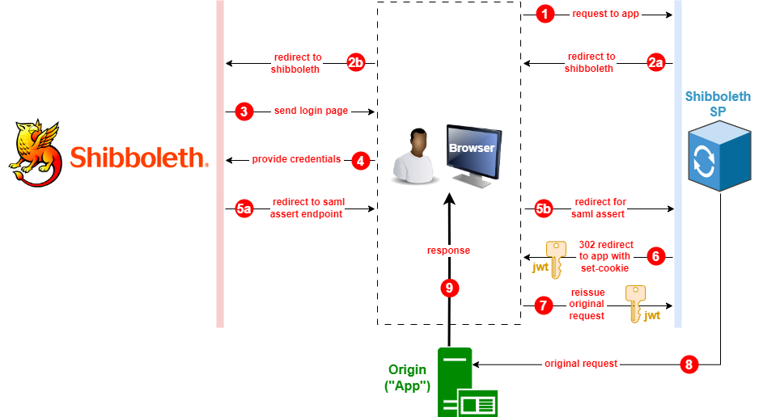

# Shibboleth-SP

Shibboleth-SP is a [nodejs](https://nodejs.org/en) [typescript](https://www.typescriptlang.org/) library that provides all service provider functionality for an application that must authenticate with a shibboleth IDP.

Basically, it acts as an **authentication proxy** that sits in front of your application and inspects incoming http request headers for [jwts](https://jwt.io/introduction) *(that it initially issued)* that provide evidence of an authenticated status. 

Requests are processed using the [saml2-js](https://www.npmjs.com/package/saml2-js) library to either verify authenticated status or drive the authentication process with the shibboleth IDP to get authenticated before passing through to the targeted application.

### Authentication flow:




This flow depicts the first of two modes that shibboleth-sp can be deployed to operate in:

1. **Basic mode:**
   In this mode, shibboleth-sp "decides" if authenticated access to the application is required. It does this on the basis of whether or not the jwt token is present, valid, and not expired. Requests that pass this test are sent through to the destination. Requests that fail this test trigger the saml flow depicted above at step 2. The application in this scenario is taking a hands-off approach to authentication and need not "know" at all that it is participating in a secure setup. This scenario would fit a minority of cases where the application requires all endpoints to be secured. 

2. **Standard mode:**
   In this mode, the application "decides" if authenticated access applies to the incoming request. It does this on whatever basis its business rules require. For this to work, shibboleth-sp will still inspect every request for a valid token, but instead of taking action upon finding an expired or missing jwt, it simply "tags" the request by appending an "authenticated" header with a "false" value and sends the it through. If the application deems the requested endpoint to require authenticated access, it finds the header is "false", and redirects back to the **`"/login"`** endpoint. Shibboleth-sp recognizes this endpoint to be one of its reserved "verbs" and will take action upon it by starting the the authentication flow as depicted in the diagram above at step 2. In this scenario, the application needs to be aware of 3 reserved headers:

   1. The name of the header *("authenticated")* that defines the incoming request as authenticated or not.
   2. The name of the header that specifies the shibboleth-sp reserved endpoint for initiating login.
   3. The name of the header that specifies the shibboleth-sp reserved endpoint for initiating logout.

   These headers are defined in the configuration section below.

### Topology:

The shibboleth-sp library is used anywhere it can intercept http traffic:

- **Inside the application** as added tooling.
  This assumes the app itself runs an http server and is in javascript with node package management.
- **On the application server** as part of the internal reverse proxying, like an [nginx](https://nginx.org/en/)/[express](https://expressjs.com/) setup that routes to your app.
  Here the app need not be restricted to nodejs.
- **External to the application server**. An example of this would be using shibboleth-sp in a [lambda@edge](https://docs.aws.amazon.com/lambda/latest/dg/lambda-edge.html) function as part of a [cloudfront distribution](https://docs.aws.amazon.com/AmazonCloudFront/latest/DeveloperGuide/distribution-working-with.html). Your app would be deployed somewhere behind a load-balancer, and cloudfront would carry out authentication.

### Usage:

A companion [shibboleth-sp-server](https://github.com/whennemuth/shibboleth-sp) github repository exists to provide an example on how this shibboleth-sp package can be used.
There you will find a rudimentary server based application using [Node Express](https://expressjs.com/) that you can run to authenticate to your Shibboleth IDP through your browser on localhost. This package is imported and used there in  `./src/EntrypointSp.ts` and follows the second "On the application server" topology item above.

### Configuration:

The `./src/Config.ts` module defines how shibboleth-sp is configured. Defaults for these can be overridden with entries in the `./.env` file:

|        Name        |       type       |   default   | environment<br />variable name | description                                                  |
| :----------------: | :--------------: | :---------: | :----------------------------: | :----------------------------------------------------------- |
|       domain       |      string      | "localhost" |            DOMAIN             | The domain for requests to your app that shibboleth-sp is "listening" to. |
|   appLoginHeader   |      string      |     n/a     |       APP_LOGIN_HEADER       | The name of a header shibboleth-sp will apply to requests. Apps will look for this header when redirecting for login. |
|  appLogoutHeader   |      string      |     n/a     |       APP_LOGOUT_HEADER       | The name of a header shibboleth-sp will apply to requests. Apps will look for this header when redirecting for logout. |
|  appAuthorization  |     boolean      |   "true"    |       APP_AUTHORIZATION       | True indicates the standard mode as described in the authentication flow section above. False indicates the basic mode as described in the authentication flow section above. |
|  samlParms.entityId  |      string      |     n/a     |           ENTITY_ID           | The entity ID of your app known to shibboleth.<br />**example:** `'https://*.myapp.bu.edu/shibboleth'` |
| samlParms.entryPoint |      string      |     n/a     |          ENTRY_POINT          | The entry point, aka IDP address of shibboleth.<br />**example:** `'https://shib-test.bu.edu/idp/profile/SAML2/Redirect/SSO'` |
| samlParms.logoutUrl  |      string      |     n/a     |          LOGOUT_URL           | The logout url used by the IDP.<br />**example:** `'https://shib.bu.edu/idp/logout.jsp'` |
|  samlParms.idpCert   |      string      |     n/a     |           IDP_CERT            | The public cert of the IDP. Navigate to the IDP entry point in a browser and acquire this cert from the `'<ds:X509Certificate>'` element. |
|   samlParms.cert     |      string      |     n/a     |           SAML_CERT           | The SAML certificate item of your service provider metadata. |
|    samlParms.key     |      string      |     n/a     |           SAML_PK             | The private key item of your service provider metadata. |
|  jwtPrivateKeyPEM  |      string      | generated | JWT_PRIVATE_KEY_PEM | A private key for JSON web token (JWT) generation. If not provided, one will be generated that lasts as long as the application process is running, which would make sense in a testing scenario. |
|  jwtPublicKeyPEM   |      string      | generated |  JWT_PUBLIC_KEY_PEM  | A public key for JSON web token (JWT) generation. If not provided, one will be generated that lasts as long as the application process is running, which would make sense in a testing scenario. |
|   customHeaders    | KeyValuePair[]   |     n/a     |              n/a               | A way to inject those headers that one wishes sp-shibboleth to append to incoming requests. Currently not available as environment variable(s). |
|     cookieName     |      string      | "auth-token-cookie" |          COOKIE_NAME           | The name of the cookie that carries the jwt. See [Sharing one sign-in across apps](#sharing-one-sign-in-across-apps-cookiedomain-and-cookiename) below. |
|    cookieDomain    |      string      | none *(host-only)* |         COOKIE_DOMAIN          | A parent domain to scope the jwt cookie to, so the browser sends it to every host beneath that domain instead of only the host that set it. Must contain `domain`. See [Sharing one sign-in across apps](#sharing-one-sign-in-across-apps-cookiedomain-and-cookiename) below.<br />**example:** `'apps.example.edu'` |

### Sharing one sign-in across apps (cookieDomain and cookieName):

**The default: one sign-in per host.** After the IDP authenticates a user, shibboleth-sp puts the jwt in a cookie with no `Domain` attribute. Such a cookie is *host-only*: the browser sends it back only to the exact host that set it. An organization that runs several related apps under one parent domain - for example one instance of a dashboard per environment at `dev.apps.example.edu`, `test.apps.example.edu` and `prod.apps.example.edu` - gets a separate sign-in at each host. Moving to another host still works without a password prompt while the user's session at the IDP lasts, because each host's login request reuses that session, but every host makes its own round trip to the IDP. Once the IDP session ends *(typically hours, set by the IDP's operators)*, the next host the user visits prompts for a password again, even though the jwt at the host they signed in at is good for days.

**Sharing the sign-in.** Setting `cookieDomain` to the apps' parent domain *(`apps.example.edu` above)* adds `Domain=apps.example.edu` to the cookie, so the browser sends it to every host beneath that domain. One sign-in at any of the hosts is then honored by all of them for the jwt's full lifetime *(7 days)*, with no further trips to the IDP. For this to work, every app that shares the sign-in must use:

- the same `cookieDomain`,
- the same `cookieName`, and
- the same jwt key pair *(`jwtPrivateKeyPEM` / `jwtPublicKeyPEM`)*, so that each app can verify a token another one issued.

`cookieDomain` must contain the `domain` shibboleth-sp is serving *(the domain itself or a parent of it)*. Browsers silently drop a cookie whose `Domain` doesn't, which would otherwise show up as a login loop, so shibboleth-sp fails such requests with a `500` that names both values. Choose a domain that contains only hosts you trust with the token: the browser sends the cookie to *every* host beneath it, including ones run by other applications, so a domain shared with unrelated apps would hand them your users' tokens. Browsers also refuse a public suffix such as `edu` or `co.uk`.

**Why `cookieName` too.** A host beneath the parent domain receives the shared cookie whether or not it takes part in the sharing. If an app that should keep its own sign-in used the same cookie name, it would receive two cookies with that name - its own and the shared one - and could read either, since browsers don't guarantee their order. Giving the shared cookie its own name *(for example `apps-auth`)* keeps the two apart: each app reads only the cookie with its configured name and ignores the other. An app that must not accept the shared sign-in at all should also use its own jwt key pair. A different name only stops the browser from presenting the shared token; a different key pair stops the app from accepting it.

**Logout.** Logging out clears the cookie with the same name and `Domain` it was set with, so logging out at one app that shares the sign-in signs the browser out of all of them. Logging out at an app with a host-only cookie signs out of that app only. Logout never revokes a jwt that has already been issued; it removes the cookie from that browser.

**Apps that read the cookie themselves.** An app that decodes the jwt cookie itself, rather than relying on the headers shibboleth-sp adds, must look it up by the configured name: use `JwtTools#getCookieName()` instead of the static `JwtTools.COOKIE_NAME`, which is only the default.

**Changing either setting** leaves any cookie already in a browser under the old name or scope until it expires. It is harmless, since shibboleth-sp reads only the cookie with the configured name, but users sign in once more after the change.

### Build:

Requires Node.js 22+.

```
npm install
npm run build
```

This produces:

- `dist/cjs/index.js` - CommonJS build, used by both `require()` and `import`
- `dist/cjs/index.js.map` - source map
- `dist/types/index.d.ts` - type declarations

The packages listed under `dependencies` in package.json *(jsonwebtoken, ms, node-forge, @xmldom/xmldom)* are installed by consumers. `saml2-js` and its own dependencies are bundled into the build instead, so that the patched versions forced by this project's `overrides` ship with the package.
To only type-check the source, run `npm run typecheck`.

**Why CommonJS only:** the inlined `saml2-js` / XML-crypto code (and the external `node-forge` crypto library) is CommonJS-only and `require`s Node built-ins such as `crypto`. An ES module build of it would need a `createRequire(import.meta.url)` shim, but downstream bundlers that output CommonJS *(CDK `NodejsFunction`, Lambda@Edge bundles, shibboleth-sp-server)* pick the ES module build through the `import` condition and lose `import.meta.url` when converting it, so the shim crashes at load time with `ERR_INVALID_ARG_VALUE`. ES module consumers lose nothing: Node imports CommonJS packages with named exports, so `import { JwtTools } from 'shibboleth-sp'` works. The build fails if `import.meta` ever appears in `dist/cjs/index.js`.

**Source maps:** the `SOURCEMAP` environment variable controls what the source maps contain:

- `app` *(default)* - the map embeds the TypeScript source of this package only, so consumers can step through it in a debugger.
- `full` - the map also embeds the source of the bundled saml2-js code *(much larger package)*.
- `none` - no source map *(smallest package)*.

```
SOURCEMAP=none npm run pack
```

**Debugging from a consumer project:** VS Code ignores source maps under `node_modules` by default. To step through this package's TypeScript, add it to the launch configuration's `resolveSourceMapLocations`:

```
"resolveSourceMapLocations": [ "${workspaceFolder}/**", "${workspaceFolder}/node_modules/shibboleth-sp/**" ]
```

To see TypeScript locations in stack traces, run node with `--enable-source-maps`.

### Package and publish:

To create a package that is ready to publish to a npm registry *(this runs the build automatically)*:

```
npm run pack
```

To publish to a npm registry *(this also runs the build automatically)*:

```
npm run release
```

*NOTE: Change the name property for of the project (and possibly the version) in the package.json file be for running the above steps.*
*Bump the version whenever you re-pack with changes: projects that install the tarball by file path (like shibboleth-sp-server) may otherwise keep installing the old contents.*

### Unit Tests

To run any and all jest tests *.test.ts, use:

```
npm run test
```

### Release notes

- **1.3.0** - Adds the optional `cookieName` and `cookieDomain` settings (`IConfig`, or the `COOKIE_NAME` / `COOKIE_DOMAIN` environment variables) for sharing one sign-in across apps under a parent domain; see [Sharing one sign-in across apps](#sharing-one-sign-in-across-apps-cookiedomain-and-cookiename). `JwtTools` takes them as constructor options (`CookieOptions`) and uses them when setting, clearing and reading the cookie; `getCookieName()` now returns the configured name, and `getCookieDomain()` is new. `hostIsWithinCookieDomain()` is exported. With neither setting, behavior is unchanged: a host-only `auth-token-cookie`.
- **1.2.0** - Ships as CommonJS only: the ES module build (`dist/esm/index.mjs`) is removed, and `import` and `require` both resolve to `dist/cjs/index.js`. Fixes the load-time `ERR_INVALID_ARG_VALUE` crash (`createRequire(undefined)`) when a consumer re-bundles the package to CommonJS. Consumers can remove any `alias: { 'shibboleth-sp': require.resolve('shibboleth-sp') }` workaround from their bundler configuration. The public API is unchanged.

